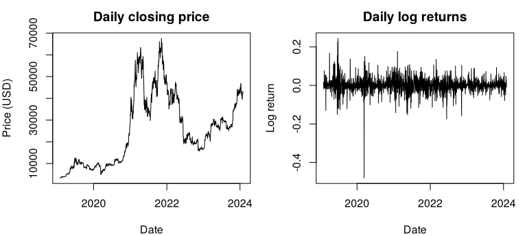
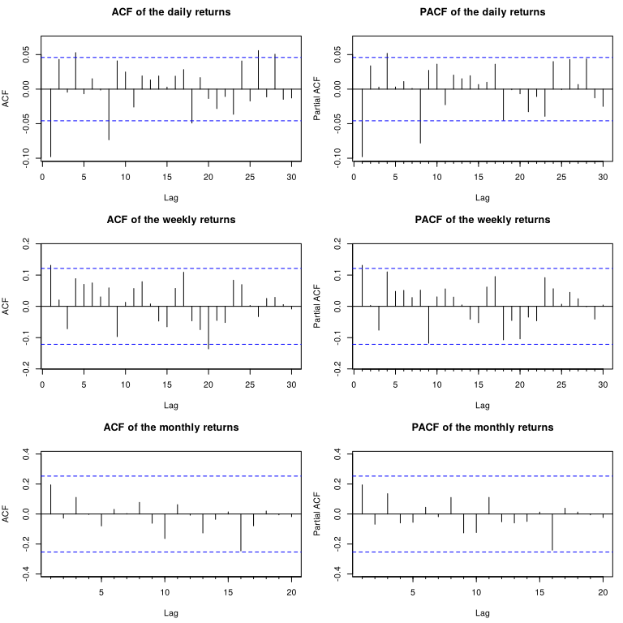
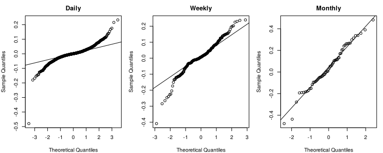
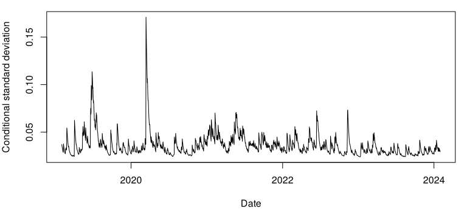
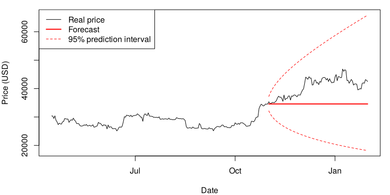

Can past prices forecast the price of Wrapped Bitcoin? ARIMA and GARCH
models at daily, weekly and monthly frequency
================
Delphine HOUNYE, African School of Economics
February 2024 (updated November 2026)

- [Abstract](#abstract)
- [1 Introduction](#1-introduction)
- [2 Related literature](#2-related-literature)
- [3 Data](#3-data)
- [4 Methodology](#4-methodology)
  - [4.1 Returns and stationarity](#41-returns-and-stationarity)
  - [4.2 ARIMA models and their
    selection](#42-arima-models-and-their-selection)
  - [4.3 Residual diagnostics](#43-residual-diagnostics)
  - [4.4 GARCH model](#44-garch-model)
  - [4.5 Forecast evaluation](#45-forecast-evaluation)
- [5 Results](#5-results)
  - [5.1 Descriptive statistics and
    stationarity](#51-descriptive-statistics-and-stationarity)
  - [5.2 Seasonal pattern](#52-seasonal-pattern)
  - [5.3 ARIMA models](#53-arima-models)
  - [5.4 Residual diagnostics](#54-residual-diagnostics)
  - [5.5 Volatility of the daily
    returns](#55-volatility-of-the-daily-returns)
  - [5.6 Forecast evaluation](#56-forecast-evaluation)
- [6 Limitations](#6-limitations)
- [7 Conclusion](#7-conclusion)
- [References](#references)

# Abstract

This project studies whether the past prices of Wrapped Bitcoin (WBTC)
help to forecast its future prices. I use five years of daily prices,
from 31 January 2019 to 31 January 2024, and I model the closing price
at the daily, weekly and monthly frequencies with ARIMA models. At the
three frequencies, the log price is not stationary, its returns are
stationary and I find no seasonal pattern. The selected models are
ARIMA(1,1,0) for the daily price and the random walk for the weekly and
monthly prices. The daily returns have very frequent extreme values and
a variance that changes over time, which a GARCH(1,1) model captures.
These features fade at lower frequencies. On three months of data not
used for the estimation, the daily model does not forecast significantly
better than the random walk.

# 1 Introduction

Cryptocurrencies are traded every day and their prices move a lot. A
natural question is whether their past prices help to forecast their
future prices. If prices already reflect the available information, as
in the efficient market hypothesis (Fama, 1970), the price should behave
like a random walk and its past should be of little use to forecast its
future.

This project studies this question for Wrapped Bitcoin (WBTC), a token
that is backed one-to-one by Bitcoin, so that its price follows the
price of Bitcoin. I use the daily prices of WBTC in US dollars from 31
January 2019 to 31 January 2024. The project answers three questions:

1.  Which ARIMA model describes the closing price at the daily, weekly
    and monthly frequencies?
2.  How do the properties of the returns change with the frequency?
3.  Does the selected daily model forecast better than a random walk on
    data that were not used to estimate it?

The main results are the following. At the three frequencies, the log
price has a unit root and the selected model is a random walk or very
close to it: ARIMA(1,1,0) with a small negative coefficient for the
daily price, and ARIMA(0,1,0) for the weekly and monthly prices. The
daily returns have heavy tails and a changing variance. These features
are weaker in the weekly returns and are not detected in the monthly
returns. Out of sample, the daily model is not significantly better than
the random walk.

This report is the final project of the Quantitative Finance course of
the Master in Mathematics, Economics and Statistics (MMES) at the
African School of Economics. The assignment asked to download five years
of daily prices for one asset, to plot the series, to specify an ARIMA
model for the daily, weekly and monthly closing prices, and to comment
on the differences between the three models. I submitted the project in
February 2024 and reworked it in November 2026: I corrected the way the
series are differenced, the choice of the models and the reading of the
residual tests, and I added the volatility model and the forecast
evaluation, which were not in the assignment.

The report is organised as follows. Section 2 presents the related
literature. Section 3 describes the data. Section 4 presents the
methods. Section 5 gives the results. Section 6 discusses the
limitations and Section 7 concludes.

# 2 Related literature

The starting point is the efficient market hypothesis. In its weak form,
prices reflect all the information contained in past prices, so that
returns cannot be forecast from their own past (Fama, 1970). A random
walk for the log price is the simplest model consistent with this idea.

Empirical work on asset returns has documented properties that are
common to many markets. Cont (2001) presents them as a set of stylized
facts. Four of them matter here: returns have little linear
autocorrelation; their distribution has heavy tails; large movements
come in clusters (volatility clustering); and the distribution of
returns gets closer to a normal distribution when the returns are
computed over longer periods (aggregational Gaussianity).

Volatility clustering is usually modelled with the ARCH model of Engle
(1982) and its generalisation, the GARCH model of Bollerslev (1986), in
which the variance of today depends on past shocks and on past
variances.

Several studies apply these tools to Bitcoin. Urquhart (2016) tests the
efficiency of the Bitcoin market and finds that returns are inefficient
over his full sample, but that the market may be moving towards
efficiency in the later part of the sample. Nadarajah and Chu (2017)
show that a power transformation of Bitcoin returns satisfies the
efficient market hypothesis. Katsiampa (2017) compares several GARCH
models on Bitcoin prices and finds that a model with a short-run and a
long-run component of the variance fits best.

This project is much simpler than these studies: it uses one asset and
standard models. It checks whether the same properties appear for WBTC
between 2019 and 2024, and how they change between the daily, weekly and
monthly frequencies.

# 3 Data

The data are the daily prices of WBTC in US dollars (ticker `WBTC-USD`),
downloaded from Yahoo Finance with the R package `quantmod`. They are
saved in the file `wbtc_usd_daily.csv` so that the results can be
reproduced without a new download.

The sample has 1827 daily observations, from 31 January 2019 to 31
January 2024. There is no missing value and no missing day, because WBTC
is traded every day of the week. I use the closing price.

For the weekly and monthly series, I keep the closing price of the last
day of each week and of each month, which gives 262 weekly and 61
monthly observations. I do not use the average price of the period,
because averaging prices creates an artificial autocorrelation in the
returns (Working, 1960).

Figure 1 shows the daily closing price and the daily log returns. The
price goes from about 3,500 USD at the end of January 2019 to about
42,500 USD at the end of January 2024. The lowest closing price is 3,396
USD (7 February 2019) and the highest is 67,549 USD (8 November 2021).
The lowest daily return is on 12 March 2020, the day of the market crash
at the start of the Covid-19 pandemic, when the price lost 38% in one
day.

**Figure 1.** Daily closing price of WBTC and daily log returns, 31
January 2019 to 31 January 2024.

# 4 Methodology

## 4.1 Returns and stationarity

Let $P_t$ be the closing price at date $t$. I work with the log price
$\ln P_t$ and with the log return

$$r_t = \ln P_t - \ln P_{t-1},$$

which is close to the percentage change of the price.

An ARIMA model requires a stationary series. I test the stationarity of
the log price and of the returns with two tests that have opposite null
hypotheses. The null hypothesis of the Augmented Dickey-Fuller (ADF)
test (Dickey and Fuller, 1979) is that the series has a unit root, so it
is not stationary. The null hypothesis of the KPSS test (Kwiatkowski et
al., 1992) is that the series is stationary. A series is considered
stationary when the ADF test rejects its null hypothesis and the KPSS
test does not reject its own.

I also check whether there is a seasonal pattern before using a seasonal
model. I regress the daily returns on indicators of the day of the week,
then of the month of the year, and I test whether the mean return is the
same for all days and for all months.

## 4.2 ARIMA models and their selection

If the log price needs one difference to become stationary, an
ARIMA($p$,1,$q$) model for the log price is an ARMA($p$,$q$) model for
the returns (Box and Jenkins, 1970):

$$r_t = \phi_1 r_{t-1} + \dots + \phi_p r_{t-p} + \varepsilon_t + \theta_1 \varepsilon_{t-1} + \dots + \theta_q \varepsilon_{t-q},$$

where $\varepsilon_t$ is a white noise. The model with $p = q = 0$ is
the random walk: the return is a white noise and the best forecast of
the price of tomorrow is the price of today. The models are estimated
without a constant, because the mean return is not significantly
different from zero at the three frequencies (Table 1).

For each frequency, I look at the autocorrelation function (ACF) and at
the partial autocorrelation function (PACF) of the returns, and I
estimate by maximum likelihood all the models with $p$ and $q$ between 0
and 3, which gives 16 models. I compare them with two information
criteria:

$$AIC = -2 \ln L + 2k, \qquad BIC = -2 \ln L + k \ln n,$$

where $L$ is the likelihood, $k$ the number of estimated parameters and
$n$ the number of observations. The best model has the lowest value. The
BIC penalises additional parameters more than the AIC. I select the
model with the lowest BIC, and I check the choice with the automatic
search of the function `auto.arima()` (Hyndman and Khandakar, 2008).

## 4.3 Residual diagnostics

A model is adequate if its residuals look like a white noise. I check
three properties:

- no autocorrelation, with the Ljung-Box test on the residuals (Ljung
  and Box, 1978), at 10 and 20 lags;
- normal distribution, with the Jarque-Bera test (Jarque and Bera,
  1987);
- constant variance, with the Ljung-Box test on the squared residuals.
  Autocorrelation in the squared residuals indicates an ARCH effect.

For each test, the null hypothesis is the property itself, so a p-value
above 5% is the good result.

## 4.4 GARCH model

When the variance of the residuals changes over time, I estimate a
GARCH(1,1) model (Bollerslev, 1986) for the daily returns, together with
an autoregressive term for the mean:

$$r_t = \mu + \phi_1 r_{t-1} + \varepsilon_t, \qquad \varepsilon_t = \sigma_t z_t,$$

$$\sigma_t^2 = \omega + \alpha \varepsilon_{t-1}^2 + \beta \sigma_{t-1}^2,$$

where $z_t$ is a standard normal white noise. The variance of today,
$\sigma_t^2$, depends on the squared shock of yesterday through $\alpha$
and on the variance of yesterday through $\beta$. The sum
$\alpha + \beta$ measures how long a shock on the volatility lasts.

## 4.5 Forecast evaluation

A model can fit the past well and forecast badly. I estimate the daily
model without the last three months of the sample (1 November 2023 to 31
January 2024, 92 days), and I compare its forecasts with the real prices
of these three months.

Each day of the test period, the model forecasts the price of the next
day with the coefficient estimated on the training period. I compare
these forecasts with those of the random walk, using the root mean
squared error (RMSE) and the mean absolute error (MAE):

$$RMSE = \sqrt{\frac{1}{H} \sum_{t=1}^{H} (P_t - \hat{P}_t)^2}, \qquad MAE = \frac{1}{H} \sum_{t=1}^{H} |P_t - \hat{P}_t|,$$

where $\hat{P}_t$ is the forecast and $H$ the number of days of the test
period. The test of Diebold and Mariano (1995) tells whether the
difference in accuracy between the two models is statistically
significant. I also compute the forecast for the whole test period made
on the last day of the training period, with its 95% prediction
interval.

# 5 Results

## 5.1 Descriptive statistics and stationarity

**Table 1.** Descriptive statistics of the log returns. The last column
is the p-value of the test that the mean return is equal to zero.

| Frequency | Obs. |   Mean | Std. dev. |    Min |   Max | Skewness | Kurtosis | p (mean = 0) |
|:----------|-----:|-------:|-----------|-------:|------:|---------:|---------:|--------------|
| Daily     | 1826 | 0.0014 | 0.0371    | -0.480 | 0.244 |    -0.95 |    22.46 | 0.114        |
| Weekly    |  261 | 0.0096 | 0.0900    | -0.409 | 0.239 |    -0.58 |     5.28 | 0.086        |
| Monthly   |   60 | 0.0418 | 0.1974    | -0.478 | 0.482 |    -0.14 |     2.85 | 0.106        |

Table 1 describes the returns. The mean daily return is 0.14% and its
standard deviation is 3.7%. At the three frequencies, the mean return is
not significantly different from zero at the 5% level.

The kurtosis of the daily returns is 22.5, far above the value of 3 of a
normal distribution: very large returns are much more frequent than
under a normal distribution. The kurtosis falls to 5.3 for the weekly
returns and to 2.8 for the monthly returns. Figure 1 also shows that
large daily returns come in groups.

**Table 2.** Stationarity tests. The p-values are bounded: 0.01 means
0.01 or less, and 0.10 means 0.10 or more.

| Frequency | Series      | ADF statistic | ADF p-value | KPSS statistic | KPSS p-value |
|:----------|:------------|---------------|-------------|----------------|--------------|
| Daily     | log price   | -1.870        | 0.633       | 3.162          | 0.01         |
| Daily     | log returns | -11.397       | 0.010       | 0.244          | 0.10         |
| Weekly    | log price   | -2.117        | 0.527       | 0.698          | 0.01         |
| Weekly    | log returns | -5.095        | 0.010       | 0.217          | 0.10         |
| Monthly   | log price   | -2.041        | 0.558       | 0.278          | 0.01         |
| Monthly   | log returns | -3.600        | 0.041       | 0.185          | 0.10         |

Table 2 gives the stationarity tests. For the log price, the ADF test
never rejects the unit root (p-values above 0.50) and the KPSS test
always rejects stationarity. For the returns, the ADF test rejects the
unit root and the KPSS test does not reject stationarity. The evidence
is weaker for the monthly returns (ADF p-value of 0.04), which have only
60 observations.

The log price is therefore integrated of order 1 at the three
frequencies: one difference is enough.

## 5.2 Seasonal pattern

The mean daily return does not differ significantly between the days of
the week (p-value = 0.11) or between the months of the year (p-value =
0.70). I do not find a seasonal pattern, so I use ARIMA models without a
seasonal part.

## 5.3 ARIMA models

**Figure 2.** Autocorrelation and partial autocorrelation functions of
the returns. The dashed lines are the 95% confidence band.

Figure 2 shows the ACF and the PACF of the returns. All the
autocorrelations are small. For the daily returns, the first one is
negative (about -0.10) and clearly outside the confidence band, and a
few others are just outside the band. For the weekly returns, the first
one is positive (0.13) and just outside the band. For the monthly
returns, none is outside the band. This suggests models with very few
terms.

**Table 3.** AIC and BIC of four of the 16 estimated models. At each
frequency, the model with the lowest AIC and the model with the lowest
BIC among the 16 are in this table.

| Model        | Daily AIC | Daily BIC | Weekly AIC | Weekly BIC | Monthly AIC | Monthly BIC |
|:-------------|----------:|----------:|-----------:|-----------:|------------:|------------:|
| ARIMA(0,1,0) |  -6849.21 |  -6843.70 |    -512.47 |    -508.91 |      -20.78 |      -18.68 |
| ARIMA(1,1,0) |  -6864.25 |  -6853.23 |    -515.69 |    -508.56 |      -21.96 |      -17.77 |
| ARIMA(0,1,1) |  -6862.97 |  -6851.95 |    -515.38 |    -508.25 |      -22.31 |      -18.12 |
| ARIMA(1,1,1) |  -6864.89 |  -6848.36 |    -513.70 |    -503.01 |      -20.56 |      -14.28 |

Table 3 compares the models.

**Daily price.** The BIC selects ARIMA(1,1,0), and `auto.arima()` gives
the same model. The AIC is slightly lower for ARIMA(1,1,1), by less
than 1. Both are clearly better than the random walk, whose AIC is
higher by about 15. I keep ARIMA(1,1,0), the simpler model. Its
autoregressive coefficient is -0.096, with a standard error of 0.023. It
is statistically significant, negative and small: a positive return
tends to be followed by a slightly lower return the next day. Apart from
this small correction, the log price behaves like a random walk.

**Weekly price.** The two criteria do not agree. The BIC selects the
random walk, ARIMA(0,1,0), and `auto.arima()` gives the same model. The
AIC is lower for ARIMA(1,1,0), by about 3, and the BIC of the two models
is almost the same. In ARIMA(1,1,0), the autoregressive coefficient is
0.14 with a standard error of 0.06: it is significant at the 5% level,
but the evidence is weak. I follow the BIC, as for the daily price, and
keep the random walk.

**Monthly price.** The BIC selects the random walk, and `auto.arima()`
gives the same model. The AIC is slightly lower for ARIMA(0,1,1), but
its moving average coefficient (0.26, standard error of 0.14) is not
significant at the 5% level. I keep the random walk.

## 5.4 Residual diagnostics

**Table 4.** p-values of the tests on the residuals of the selected
models: ARIMA(1,1,0) for the daily price, ARIMA(0,1,0) for the weekly
and monthly prices.

| Test                                   | Null hypothesis    | Daily | Weekly | Monthly |
|:---------------------------------------|:-------------------|------:|-------:|--------:|
| Ljung-Box, residuals (10 lags)         | No autocorrelation | 0.014 |  0.138 |   0.776 |
| Ljung-Box, residuals (20 lags)         | No autocorrelation | 0.048 |  0.054 |   0.837 |
| Jarque-Bera                            | Normality          | 0.000 |  0.000 |   0.916 |
| Ljung-Box, squared residuals (10 lags) | Constant variance  | 0.000 |  0.794 |   0.803 |

**Figure 3.** Normal Q-Q plots of the residuals of the selected models.

Table 4 and Figure 3 show how the residuals change with the frequency.

For the daily model, the residuals are not a white noise. The Ljung-Box
test rejects the absence of autocorrelation at the 5% level but not at
the 1% level. The remaining autocorrelations are small, and none of the
16 models passes this test at the 5% level, so adding terms does not
solve it. The Jarque-Bera test rejects normality: in Figure 3, the
points are far from the line at both ends. The test on the squared
residuals rejects a constant variance. The ARIMA(1,1,0) model describes
the mean of the daily returns, but not their variance.

For the weekly model, the tests do not reject the absence of
autocorrelation or a constant variance. Normality is still rejected,
with fewer extreme values than in the daily data.

For the monthly model, no test rejects its null hypothesis: the
residuals are close to a normal white noise. With 61 observations, these
tests have less power than with the daily data, so small departures
could remain undetected.

These results agree with the stylized facts of Cont (2001): heavy tails
and volatility clustering in the daily returns, and a distribution that
gets closer to the normal distribution when the frequency decreases.

## 5.5 Volatility of the daily returns

**Table 5.** Estimates of the AR(1)-GARCH(1,1) model for the daily
returns.

| Parameter                 | Estimate | Std. error | p-value |
|:--------------------------|---------:|-----------:|--------:|
| mu (mean)                 |  0.00196 |    0.00076 |  0.0094 |
| phi (autoregressive term) | -0.06891 |    0.02883 |  0.0168 |
| omega                     |  0.00010 |    0.00002 |  0.0000 |
| alpha                     |  0.12052 |    0.02126 |  0.0000 |
| beta                      |  0.81851 |    0.02546 |  0.0000 |

Table 5 gives the estimates of the GARCH model. The coefficients
$\alpha$ (0.12) and $\beta$ (0.82) are both significant. Their sum is
0.94, close to 1: a shock on the volatility lasts a long time before it
disappears. The autoregressive coefficient is still negative and
significant.

**Figure 4.** Daily volatility estimated by the GARCH(1,1) model.

Figure 4 shows the estimated daily volatility. It goes from 2.4% in
January 2023 to 17% on 13 March 2020, the day after the crash. It is
also high in mid-2019, and it is lower in 2023.

With the GARCH model, the standardized residuals have no autocorrelation
left (Ljung-Box p-values of 0.32 at 10 lags and 0.63 at 20 lags) and no
changing variance left (p-value of 0.95 on the squared standardized
residuals). The two problems of the daily ARIMA model are solved. The
Jarque-Bera test still rejects normality: even after taking the
volatility into account, extreme returns such as the crash of March 2020
are more frequent than under a normal distribution.

## 5.6 Forecast evaluation

**Table 6.** Accuracy of the one-day-ahead forecasts on the test period
(1 November 2023 to 31 January 2024, 92 days).

| Model        | RMSE (USD) | MAE (USD) |
|:-------------|-----------:|----------:|
| ARIMA(1,1,0) |     1006.4 |     704.1 |
| Random walk  |     1016.2 |     718.1 |

Table 6 compares the one-day-ahead forecasts. The RMSE of the
ARIMA(1,1,0) model is 1,006 USD, against 1,016 USD for the random walk.
The model is slightly better, but the difference is about 1% and the
Diebold-Mariano test does not reject equal accuracy (p-value = 0.26).
Over these three months, the ARIMA model does not forecast significantly
better than the random walk.

**Figure 5.** Forecast made on 31 October 2023 for the next three
months, and real price.

Figure 5 shows the forecast made on 31 October 2023 for the whole test
period. The forecast is almost flat at about 34,600 USD, the price of
the last day of the training period, because the model is close to a
random walk. The real price rose to 42,502 USD at the end of January
2024. All the real prices are inside the 95% prediction interval, but
this interval is very wide: after three months, it goes from about
18,000 to 66,000 USD. The model gives the right order of magnitude of
the uncertainty, but it cannot say in which direction the price will
move.

# 6 Limitations

The analysis covers one asset and five years. This period includes one
very large crash, in March 2020, which has a strong influence on the
kurtosis and on the tests.

The GARCH model uses normal errors, and the tests reject the normality
of its standardized residuals. A distribution with heavier tails for the
errors would be the next step.

The forecast evaluation uses one test period of three months. The result
could differ in another period.

The monthly series has 61 observations only, so the tests have little
power at this frequency. The absence of rejection does not prove that
the monthly returns are a normal white noise.

# 7 Conclusion

The log price of WBTC is not stationary and its returns are stationary,
at the daily, weekly and monthly frequencies, and I find no seasonal
pattern. The selected models are ARIMA(1,1,0) for the daily price and
the random walk for the weekly and monthly prices.

The daily returns have a small negative autocorrelation, very frequent
extreme values and a variance that changes over time, which a GARCH(1,1)
model captures. These features fade when the frequency decreases, and
the monthly returns are close to a normal white noise.

Out of sample, the daily model does not forecast significantly better
than the random walk. Over this period, the past prices of WBTC give
very little information on the direction of its future price, which is
consistent with the weak form of the efficient market hypothesis. What
can be modelled is the size of the movements of the price, not their
direction.

# References

Bollerslev, T. (1986). Generalized autoregressive conditional
heteroskedasticity. *Journal of Econometrics*, 31(3), 307-327.

Box, G. E. P. and Jenkins, G. M. (1970). *Time Series Analysis:
Forecasting and Control*. San Francisco: Holden-Day.

Cont, R. (2001). Empirical properties of asset returns: stylized facts
and statistical issues. *Quantitative Finance*, 1(2), 223-236.

Dickey, D. A. and Fuller, W. A. (1979). Distribution of the estimators
for autoregressive time series with a unit root. *Journal of the
American Statistical Association*, 74(366), 427-431.

Diebold, F. X. and Mariano, R. S. (1995). Comparing predictive accuracy.
*Journal of Business and Economic Statistics*, 13(3), 253-263.

Engle, R. F. (1982). Autoregressive conditional heteroscedasticity with
estimates of the variance of United Kingdom inflation. *Econometrica*,
50(4), 987-1007.

Fama, E. F. (1970). Efficient capital markets: a review of theory and
empirical work. *The Journal of Finance*, 25(2), 383-417.

Hyndman, R. J. and Khandakar, Y. (2008). Automatic time series
forecasting: the forecast package for R. *Journal of Statistical
Software*, 27(3), 1-22.

Jarque, C. M. and Bera, A. K. (1987). A test for normality of
observations and regression residuals. *International Statistical
Review*, 55(2), 163-172.

Katsiampa, P. (2017). Volatility estimation for Bitcoin: a comparison of
GARCH models. *Economics Letters*, 158, 3-6.

Kwiatkowski, D., Phillips, P. C. B., Schmidt, P. and Shin, Y. (1992).
Testing the null hypothesis of stationarity against the alternative of a
unit root. *Journal of Econometrics*, 54(1-3), 159-178.

Ljung, G. M. and Box, G. E. P. (1978). On a measure of lack of fit in
time series models. *Biometrika*, 65(2), 297-303.

Nadarajah, S. and Chu, J. (2017). On the inefficiency of Bitcoin.
*Economics Letters*, 150, 6-9.

Urquhart, A. (2016). The inefficiency of Bitcoin. *Economics Letters*,
148, 80-82.

Working, H. (1960). Note on the correlation of first differences of
averages in a random chain. *Econometrica*, 28(4), 916-918.
